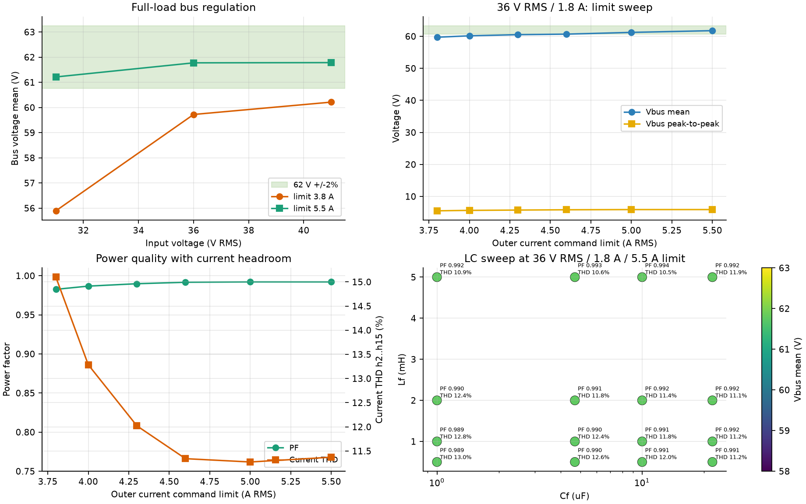
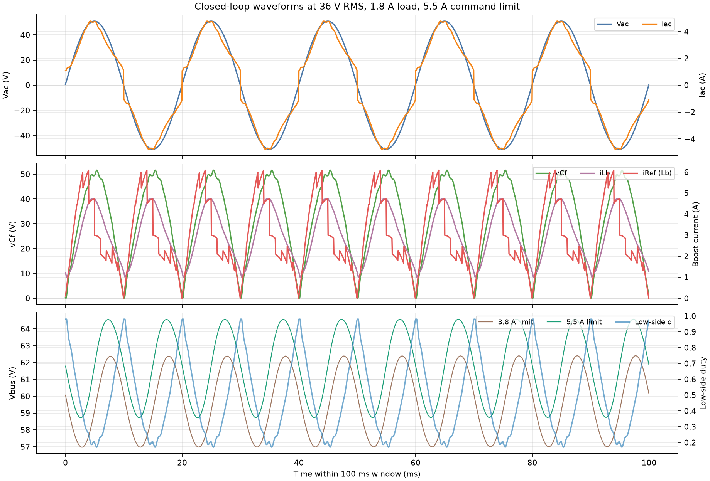

# 单半桥 ACDC 降级拓扑仿真

## 1. 结论摘要

本仿真针对实际只剩**一个半桥模块**时的 ACDC 方案：

```text
单相 AC
   │
   ├─ 4×肖特基不控全桥
   │
   ├─ Lf ──┬── Lb ── 单半桥 ── Cbus ── 负载
   │       │
   │      Cf
   │       │
   └───────┴── 回流地
```

平均模型得到的结论是：

1. **拓扑本身可以闭环稳到 62 V，并能带 1.8 A 恒流负载。**
   在 31/36/41 V RMS 输入、5.5 A 外环电流指令限幅下，母线均值分别为
   61.21/61.77/61.78 V，均在 62 V ±2% 内。
2. **旧固件的 3.8 A 电流指令限幅不够。**
   同一组输入下，3.8 A 限幅只能得到 55.89/59.72/60.21 V，满载母线不达标，
   且仿真中约 60%–70% 的工频周期处在限幅状态。
3. **旧全桥 PFC 控制器不能原样烧到这个功率级。**
   `rectifier_pwm.c` 生成两个相差 180°、围绕 50% 的桥臂；新拓扑只有一组
   互补半桥，应改用“下管 d、上管 1−d、死区互锁”的单桥 Boost PWM。
4. **直接零母线合闸风险很高。**
   理想交流源、无限流模型中，前 20 ms 的 LC/体二极管预充可达到约
   `ILb=24.6 A`、`ILf=24.7 A`、`Vbus=85.8 V`。实机必须使用电源限流、
   预充电阻/NTC 或其他受控预充；MCU 闭环不能替代这一段硬件保护。
5. **PF 好看不等于 THD 达标。**
   36 V RMS、1.8 A、5.5 A 限幅时为 PF=0.992、THD(h2..h15)=11.4%。
   PF 高是因为基波相位好，THD 仍有 11% 左右，不能宣称满足常见的
   THD<5% 指标。轻载 0.5 A 时 THD 进一步升到 26.4%。

> 这是开关周期平均模型，不是产品级器件模型。结论用于判断拓扑、量程和控制
> 方向，不能代替示波器、功率分析仪和热测试。

> **5.5 A 只是模型里的诊断性指令上限，不是允许直接烧进固件的电流额定值。**
> 5.5 A RMS 若被电流环真正跟踪，峰值会达到 7.78 A，超过旧固件的 5.6 A
> 过流阈值和约 5.68 A 的正向采样量程。这个数字说明“旧 3.8 A 指令余量
> 不足”，不说明硬件可以安全承受 5.5 A RMS。

## 2. 仿真边界与假设

| 项目 | 默认值 | 说明 |
|---|---:|---|
| 输入 | 31/36/41 V RMS，50 Hz | 旧赛题参数范围 |
| 母线目标 | 62 V | `app_config.c` 的生产目标 |
| 负载 | 1.8 A 恒流 | 约等于 111.6 W @ 62 V |
| 肖特基压降 | 0.45 V/只 | 整流回路按两只串联，共 0.9 V |
| Lf | 2 mH | **假设值**，必须按实物替换 |
| Cf | 10 uF | **假设值**，必须按实物替换 |
| Lb | 1 mH | **假设值**，必须按实物替换 |
| Cbus | 1000 uF | **假设值**，必须按实物替换 |
| Lf/Lb DCR | 50 mΩ | 仅一阶铜损 |
| 开关频率 | 20 kHz | 平均模型不画开关纹波 |
| 死区 | 未建模 | 实机必须按驱动器和 MOSFET 重新核算 |
| 开关/磁芯损耗 | 未建模 | 因此效率数字偏乐观 |

仿真步长为 2 µs，控制频率为外环 1 kHz、内环 20 kHz；输入 RMS 使用与固件
一致的 400 点、20 ms 滑动窗口。

## 3. 控制结构

> 本文件前半部分是拓扑研究模型，使用理想 `|Vac|` 做电流参考。最终 ACAC
> 硬件不能在 PC2 上增加 Vcf，只在 PC5 提供一个桥后 Vcf 采样；对应固件和
> 独立复算模型改为 `Iref = Iamp·Vcf/Vcf,rms`，见
> `standalone/acdc_halfbridge_f407/host_tests/sim_input_current.c`。

仿真没有使用固定占空比。固定占空比在 Cbus 有电、输入幅值和负载变化时无法
维持 62 V。

```text
母线电压 PI（1 kHz + 100 Hz 陷波）
        │
        └─► Iamp（输入电流 RMS 指令）
                │
                └─► Iref = Iamp · |Vac| / Vac,rms
                        │
                        └─► Lb 电流 PI（20 kHz）
                                │
                                └─► d = 1 − (vCf − vL) / Vbus
```

实现中额外使用 `Cf·dvCf/dt` 前馈，因为电容节点满足：

```text
iLf = iLb + Cf · dvCf/dt
```

不补偿该电流时，Boost 电感电流看似跟随指令，但真正的网侧电流会出现尖顶和
额外 THD。

控制增益没有沿用旧全桥的 `Kp=5, Ki=2000`。在本模型里，那组参数会使内环
带宽落到 `Lf/Cf` 谐振附近，产生约 1 kHz 的周期性振铃。扫描后使用
`Kp=0.4 V/A, Ki=50 V/(A·s)`。

## 4. 主要结果

### 4.1 输入电压与限幅

| Vac,rms | 3.8 A 限幅母线 | 3.8 A PF/THD | 5.5 A 限幅母线 | 5.5 A PF/THD |
|---:|---:|---:|---:|---:|
| 31 V | 55.89 V | 0.956 / 24.3% | 61.21 V | 0.987 / 13.2% |
| 36 V | 59.72 V | 0.983 / 15.1% | 61.77 V | 0.992 / 11.4% |
| 41 V | 60.21 V | 0.994 / 10.3% | 61.78 V | 0.989 / 12.9% |

### 4.2 0.5/1.0/1.8 A 负载

36 V RMS、5.5 A 指令限幅：

| 负载 | 母线均值 | PF | THD |
|---:|---:|---:|---:|
| 0.5 A | 61.95 V | 0.933 | 26.4% |
| 1.0 A | 61.89 V | 0.989 | 12.4% |
| 1.8 A | 61.77 V | 0.992 | 11.4% |

负载越轻，输入电流越接近二极管换流和零电流死区，THD/PF 越差。因此不能只测
满载后宣称全负载范围满足功率因数指标。

### 4.3 Lf/Cf 扫描

在 0.5/1/2/5 mH 与 1/4.7/10/22 uF 的组合中：

- 闭环都能把母线稳定在 61.76 V 左右；
- Lf 从 0.5 mH 增到 5 mH，THD 整体从约 12–13% 降到约 10.5–11.9%；
- 5 mH/10 uF 的最低 THD 仍为 10.5%，没有出现“换 LC 就满足 THD<5%”；
- 增大 Lf 会恶化瞬态和体积，不能只按最低 THD 选值。



### 4.4 波形

下面是 36 V RMS、1.8 A、5.5 A 指令限幅的 100 ms 波形。棕色母线是 3.8 A
限幅对照，绿色是 5.5 A 限幅；3.8 A 明显无法维持 62 V。



## 5. 对固件的影响

本仿真**没有**把新控制器直接写进 `App/`。直接烧录旧固件没有意义，原因是：

1. `RectifierPwm_Generate()` 的输出是两桥臂占空比，适配全桥 PFC；
2. 新功率级只有一个半桥，只需要一个下管占空比 `d` 和一个互补上管 `1-d`；
3. TIM8 现有两套引脚定义不能再同时当作两个有源桥臂使用；
4. 输入电流参考应从 `|Vac|/Vac,rms` 生成，不能再把 `vCf` 当成理想正弦；
5. 3.8 A 指令限幅、5.6 A 过流阈值和 TA 量程要一起重新核算，不能只改一个。

上板前至少需要：

- 确认实际使用的是 TIM8 CH1/CH1N 还是 CH2/CH2N，并断开另一组未用驱动；
- 设置互补输出、死区、MOE 和刹车路径；
- 核对高侧驱动是否为自举供电。若使用 bootstrap，`d=0.98` 时低侧刷新脉宽
  只有 1 µs，再叠加死区可能不足以维持自举电容；需要实测驱动供电或增加
  周期性刷新脉冲；
- 增加独立预充/NTC 或受限实验室电源；
- 先低压、限流、空载验证母线，再逐步加载；
- 用示波器同时看 `Vbus`、`vCf`、`ILb` 和半桥中点，确认没有直通和反向。

## 6. 复现

```powershell
cd D:\stm32proj\three-phase-inverter-readable
powershell -ExecutionPolicy Bypass -File .\host_tests\run_acdc_halfbridge_sim.ps1
```

单独运行一个工作点：

```powershell
gcc -std=c11 -O2 -Wall -Wextra -I App\Inc `
  host_tests\sim_acdc_halfbridge.c -lm `
  -o "$env:TEMP\sim_acdc_halfbridge.exe"

& "$env:TEMP\sim_acdc_halfbridge.exe" 36 1.8 10 2 --ilimit=5.5
& "$env:TEMP\sim_acdc_halfbridge.exe" 36 1.8 10 2 --ilimit=5.5 --trace
```

扫描结果在 [`acdc_halfbridge_sweep.csv`](acdc_halfbridge_sweep.csv)，图中每个点
都能由脚本重新生成。
